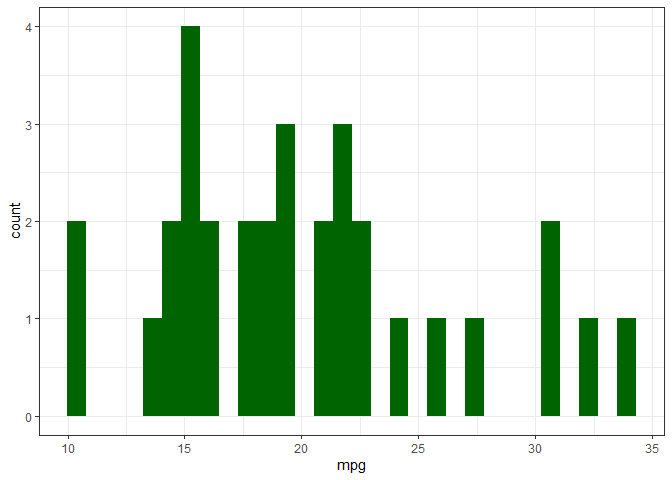

<!-- README.md is generated from README.Rmd. Please edit that file -->

# GitDay_Finse

<!-- badges: start -->

<!-- badges: end -->

The goal of GitDay_Finse is to make a little GitHub repo

For this repo, I made a little histogram:

Look at it here!

``` r
lil_hist
```

<!-- -->
